<p align="center">
  
</p>

### Gabriel Sánchez · [@Gabito909x](https://github.com/Gabito909x)

```bash
gabito909x@github:~$ whoami
Técnico en Programación de Software · SENA
Armenia, Quindío · Colombia

gabito909x@github:~$ cat ahora.txt
> Construyendo mi portafolio y mi proyecto de vida.
> Aprendiendo diseño de interfaces y JavaScript.
> Mi meta: mi primer cliente y un equipo donde crecer.

gabito909x@github:~$ ls proyectos/
proyecto-de-vida/   pp-sena/

gabito909x@github:~$ cat stack.txt
HTML · CSS · JavaScript · PHP · MySQL · Git

gabito909x@github:~$ contact --help
Abre un issue: https://github.com/Gabito909x/Gabito909x/issues/new

gabito909x@github:~$ tip
> Si funciona y se ve bien, mejor.
```

<p align="center"><sub><a href="https://github.com/Gabito909x/Gabito909x/issues/new"><code>contact --help</code></a> · <a href="https://github.com/Gabito909x?tab=repositories"><code>ls proyectos/</code></a> · <code>gabito909x</code> · <code>main</code> · <code>2026</code> · <code>El que no sueña nunca progresa.</code></sub></p>
